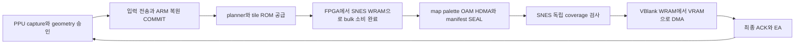

# NES499 전체 경로 재점검과 방향 수정

2026-10-30. [재계획](nes-audit499-plan.json) · [선택 소스·재분석](../analysis/audit499-verification.json) · [PR138](progress/pr-138.md).

**현재 구현은 실기에서 제한된 SMB3 장면을 표시하는 데 성공했지만, 현재 전송량과 직렬 처리 순서를 유지한 미세 최적화만으로 지속60fps에 도달할 근거는 없다.** 수집 단계의 반복 거부도 남아 있다. 다음 작업은498을 바로 성능판으로 승격하는 것이 아니라, 수집 정확성 → 전송·표시 구조 예산 → 한 후보의 전체 비교 순서다.

## 점검 대상과 확신의 범위

- 실기 기준493: 실제 ARM493와 정상489 FPGA/SNES. FPGA QSF·제약·초기화 포함70입력의 hash를 제작 증거와 재대조했다. ARM의NES75파일과NES를 참조하는 비NES26파일을 목록화했다. `.su`가 있는26 NES translation unit도 기록했다. 목록 포함은 최종 링크 생존이나 행별 검증 완료와 같지 않다.
- loader/START, PPU tap·collector/lease, source codec·ARM 복원, planner/resident, 공유SPI, plan/2bank bulk,4packet output,65816 검사·DMA·VBlank·최종ACK,STOP/base/menu 경계를 추적했다. 실제 코드는 `probes/nes-boot493/ARM01/src`, `nes-output489-board02`, `probes/nes-output489/client04`와 생성 recipe에 있다. 저장소의 오래된 동명 모듈을 현재 배포 코드로 취급하지 않았다.
- 495–498은 별도 후보다.498의 END/drain·수신 중 old identity·ACK/EA/COMMIT 변경과 비용을 검토했으며 실기493과 혼합하지 않는다. 과거131–133의 미선택 공통 실행기/FSM 수치는 현재 보드의 여유가 아니다.
- upstream T65/PPU/APU/MMC3는 연결·수정된 tap·mapper/ROM 경계를 중심으로 검토했다. CPU/PPU의 모든 명령·픽셀을 독립적으로 재검증하거나 전체reset/CDC/IO·IRQ최대stack을 sign-off한 작업은 아니다. **전체 경로 검토 완료와 모든 코드의 무결성 증명을 구분한다.**
- 이번에는 같은RTL의 Quartus/Questa를 반복하지 않았다. 새 회로·펌웨어·실기 전달본도 없다. 확인된 분석 누락과 현재 문서/우선순위를 수정했다. 원인이 입증되지 않은 수집 오류를 없애기 위해 검사 비트를 끄거나 동작 코드를 추측으로 다시 쓰지 않았다.

## 우선 발견: 수집 거부가 성능 분석에서 빠져 있었다

실기493의 V3 history를 기존 `decode_nes_minreject180.py`로 해석했다. 마지막16개 전이 중 거부8개/회복8개다. 거부8개는 모두 fetch 오류이고 compact/raster/ROM 오류는0이다.

| fetch signature | 남은 거부 episode | 실제 `nes_native_planes165.sv` 판정 |
|---|---:|---|
| 0x01 | 3 | 이전low가 pending인데 새low 도착 |
| 0x04 | 4 | high에서 pending/address/lane/geometry/짝 조건 실패 |
| 0x06 | 1 | low 주소·lane 오류와 high 짝 실패 |

거부 시 rows224/groups29/palette1이며 이 마지막 표본에서 group/palette 용량 초과가 주원인이라는 근거는 없다. 종료trace의 COMMIT576, 표시575, capture generation878은 서로 다른 진행 지표다. generation 차이302를 그대로 전체 거부 수나 손실 시간으로 계산하지 않는다. V3는 최초 오류의 행/dot, 연속 거부 중 변화, 전체 거부 개수를 저장하지 않는다.

수집기는 현재 PPU pattern-load 신호와 그 시점의 logical/physical 주소로 low/high를 짝짓는다. 정상 게임의 렌더링 중단·재개나 주소 전환과 실제 데이터 load의 대응을 확인해야 한다. [179 조사](nes-level179-investigation.ko.md)는 이미 첫 레벨의 중간 PPUMASK 중단·재개를 확인했다. 이후181 raw-row 보완은 compact/raster의 행 오류를 대체하지만 **fetch 오류는 여전히 전체 frame을 거부**한다. 이것이 이번01/04/06의 원인이라는 증명은 아직 없다. 같은 미해결 경계를 다시 발견한 것이며 신규 하드웨어 고장을 단정하지 않는다.

**수정할 접근:** run_error0·CRC0·메뉴 정상으로 capture가 건강하다고 판정하지 않는다. 새 audit 분석은 capture 상태를 별도 출력한다. 다음에는 수집기의 첫 실패 전후 low/high·PPUMASK·주소·실제load/row-commit을 짧게 재현한다. 정상 중단 때문에 생긴 행 한정 결손이면 완전한 실제raw row와 연결해 그 행만 대체하는 구조를 검토한다. source ROM 오류·주소 오염·누락 픽셀·범위 초과까지 완화하지 않는다. 참조픽셀과 반례로 구분되기 전 제품 RTL 수정은 보류한다.

## 실제 시간: 어디를 줄여야 하나

| 493 관측 | ms/최종 표시 | 해석 |
|---|---:|---|
| 전체 평균 | **104.470** | 60.07초575회 =9.572fps; 첫 레벨만의 값 아님 |
| 수신 단계 | 28.970 | 수집 준비/거부 대기·poll·전송·복원 등을 포함 |
| 계획·타일 공급 | 33.050 | ARM planner와 ROM window/credit/소비 대기 포함 |
| SEAL·최종ACK | 41.334 | ordinary 전송·검사·VRAM DMA·VBlank·ACK 포함 |
| 전체 SPI wire | 32.196 | 위 단계 내부; 합산 금지 |
| D0/E0/E8 조회 wire | 14.236 | 전체wire의44.2% |
| 조회를 모두 뺀 wire 투영 | **17.959** | 이미16.667ms 초과 |
| D1/E1/E9 body만의 wire | 15.793 | header/상태/여타비용을 넣기 전 |

2.625MHz의60Hz 한 주기에는 물리적으로5468.75 wire byte가 들어간다. 현재 D1 body3372.49B/E1 body1743.16B/E9 body66.44B의 평균부터 크다. 현재 평균에서60fps까지 처리율은 약6.27배 필요하다. **작은 루프 개선을 더하면 자연스럽게60fps가 된다는 계획은 폐기한다.**

이는 같은 작업량을 유지한다는 조건의 실기 카운터 투영이다. 마지막 미완료 시도와 보조70/73 명령도 포함하고 장면이 고정되지 않아 보편적 하한이나 최적화 후FPS 예측이 아니다. DWT 단계·driver·quiet는 중첩되며 더하지 않는다. plan 최대261.14ms도 ROM 단독 시간 또는p95가 아니다. 수집 거부·ROM grant 대기·순수ARM 계산을 아직 독립 시간으로 분리하지 못했다.

## 현재 코드가 만드는 직렬 경로

`nes_native_runtime165.c`는 planner 이후 `nes_plan200_finish()`가 모든bulk 소비를 확인한 뒤 `nes_sink212_seal()`로 나머지 출력을 보낸다. `nes_dirty212.py`의 표시 루틴은SEAL 뒤 upload loop에 들어간다. **bulk 소비 완료는 VRAM 반영이나 화면 표시 완료가 아니다.**4packet queue와2개의tile bank는 서로 다른 자원이다. ARM의첫BG선행/240Bplan flush와FPGA연속slot chunk 묶음은 이미 구현돼 있다.

498은 이전 최종ACK 대기 안에 다음 입력 수신을 겹칠 수 있게 했다. 위 경로의 일부 의존성을 줄인 후보지만 전체 성능은 미측정이다. callback 뒤128us quiet가 그대로 붙는 경로는 이전ACK 관측을 늦출 수 있으며, 겹친 수신 시간을 두 번 이득으로 더하면 안 된다.

**비교할 구조:** 확정된 출력만 일찍 보내기, 검증된 범위만 비활성VRAM에 먼저 DMA하기, 나머지tile/metadata와 중첩하기. 범위별 독립검사, bank identity·초기화 이력, STOP 후 무효화, 최종coverage와VBlank 표시 전환이 모두 필요하다. 이를 구현하지 않고SEAL만 앞당기거나ACK을 미리 공개하면 오동작이다.

## 하위 계층별 판단

| 영역 | 확인한 구현/제약 | 수정·개선 방향 |
|---|---|---|
| 입력 codec/ARM | compact 입력 압축·단일 복원·빠른CRC·raw-group reuse가 이미 있음; 여전히 전체geometry의 반복전송 비용 | 유지된base/epoch에 대한 프레임간 delta 또는 중간 재전송 제거를 전체ABI로 비교. STOP/cold/history 유효성이 필요 |
| ARM/SPI | 이미 하드웨어DMA이나 CPU는완료를poll; 매packet SPI/GPIO/DMA 설정 저장·복구와4×2us 대기 | RUN 소유권 아래 공통70/73까지 통합하는 지속설정/긴burst 후보. 완료 전 buffer 재사용이나guard 삭제 금지 |
| IRQ | MCU_RDY는external_memory_ready; packet-ready IRQ가 아님 | 기존IRQ가 모든poll을 대체한다는 가정 금지. 실제 신호·owner부터 확정 |
| tile ROM | `nes.v`의242≤scanline<260,div_cpu==3 및cache/core idle 조건에서만 fill; arbiter는core 우선 | window를 놓친 정체와 실제ROM 요청량을 분리. 단순slot 확대는NES 샘플miss 위험. mapper별 deadline과physicaltag 증거가 필요 |
| tile cache | 16B 단일physicaltile cache, immutable epoch | tag locality/연속tag 공급·제한 retained cache 후보. cache 추가 비용과 invalidation까지 비교 |
| SNES | packet 검사·WRAM staging·coverage·VRAM upload·palette/OAM/HDMA·VBlank | 필요한 검사는 유지하고 중복이동/늦은발행/직렬barrier를 변경. 새wordMVN은492부팅원인 미확정이라 보류 |
| 메모리/용량 | 493 Flash148B/136LE/5M9K,498 Flash8B/276LE/5M9K;498 comb는오히려+27 | 추가기능만쌓을 여유 없음. 후보마다 삭제하는기존코드와RAM/Flash/LE 예산 필수 |
| STOP·복구 | source epoch/lease·token·CRC·ACK·실기 메뉴복귀 근거 유지 | boundary 변경 시에만 관련회귀. clock/CSS나DMA stuck의fatalhalt까지 메뉴복귀를보장한다고쓰지않음 |
| 재현성 | 선택 소스 상당부분이probes/Temp, Python recipe 사슬; clone 완결아님 | 선택493/다음선택본을 명시적 source manifest/빌드입력으로 정리. 전체과거후보의복사는하지않음 |

전체 비용은493 **15272LE/14078comb/8392FF/264800bit/51M9K**,498 **15132LE/14105comb/8394FF/같은RAM**이다. LE140개 감소는packing 결과를 포함하며제어140개 삭제가 아니다.498 관련setup+.084ns/hold+.147ns는전체reset/CDC/IO 승인과다르다.498 callback728B는전체 IRQ중첩 stack이아니다. 비용은기존선택합성의재확인이지이번새합성결과가아니다.

## 접근의 유효 범위와 MMC4/5

NES CPU/PPU를 실행하고 의미정보를SNES tile/map/OBJ/HDMA로 옮기는 접근은 SNES 자원을 활용한다는 장점이 있다. 그러나 지금은 고정MMC3·256KiBPRG/128KiB immutableCHR,224rows/32groups/128OBJ/128exceptions/2palette/7raw-row의 **제한 renderer**다. 모든NES 화면을 일반적으로 재현하는framebuffer가 아니다. 용량·효과 제한이 실제게임에서 빈번하면 손실된프레임을속도최적화로복구할수없다.

MMC4의CHR read latch,MMC5의ExRAM/확장CHR·split·CHR-RAM 등은 현재immutable physicaltag/ROMslot 가정과별도검증이필요하다. 현재수정이끝나도문제없다고보장하지않는다. 반대로fullframe raw 전송으로바꾸는것도현재SPI/VBlank예산상자동해결이아니다. 먼저SMB3 첫레벨 정확성과 지속성을고정하고 확장가능한owner/epoch/검사경계만재사용한다.

## 재작업 보류 목록과 다시 열 조건

‘더 이상 최적화 불가능’이라는 수학적 증명은 없다. 아래는 **새 증거 없이 다시 돌리지 않을 영역**이다.

| 보류 대상 | 이유 | 다시 열 조건 |
|---|---|---|
| EB/status 단독 축소·작은word 루프 | 495 동일12frame −2.794us,위상이동 +13.316us; 실기효과없음 | 전체wire/ACK 구조가바뀌고 end-to-end 예산에기여함을입증 |
| 491/492 새SNES wordMVN | 모델7.25%는493에적용불가;실기부팅실패 | 부팅경계원인과최소반례부터해결 |
| 개별FSM/ROM opcode/counter/seed 반복 | 이전후보가실제삭제·전체throughput과분리됨 | 삭제목록·ABI·최소시간/전체면적예산을먼저통과 |
| firstBG선행·chunk묶음·DMA‘추가’ | 이미493에존재 | 실제남은종속성을특정하는차분제시 |
| CRC/독립coverage/identity/최종ACK 삭제 | correctness 경계,속도만으로제거불가 | 동등한독립검사와fault-injection이있는구조대체 |
| ROM/CDC/reset/IO 제약완화·무근거SCK상향 | timing/실기재현성희생 | 실제port/clock/보드증거와동일실기비교 |
| 변경없는384KiB loader·GBC·전체장시간Questa 재실행 | 현재FPS원인분리못함 | 해당경계의구현변경또는새실패증거 |

fast inputCRC와행reuse는유지한다. 모든CRC/ARM계산이이미최적이라는뜻은아니다. 미측정함수의이론적개선은우선순위근거로사용하지않는다.

## 다음 작업의 완료 기준

1. **A1 수집 정확성:** 실제저장된PPU 중단/재개자료와현재collector를짧게연결해01/04/06의원인을분리한다. 첫오류위치가필요하면기존witness공간을재사용한다. 전체부팅시뮬레이션을수백프레임반복하지않는다. 위치없는로그만으로검사완화하지않는다.
2. **A2 구조 예산:** 같은장면의wire body/header/query,ROM grant,ARM계산,WRAM/VRAM DMA·VBlank를owner별로계산한다.60Hz 목표wire는계산상5468.75B 미만이어야하며gap·보조명령·burst여유까지예약한다. 초기설계budget은wire12ms/3937.5B,남은4.667ms는겹치지않는critical path용으로두되실측으로수정한다. 이는합격실측이아니다.
3. **A3 한 구조 구현:** delta/persistentSPI와early inactiveVRAM 중예산이성립하는한후보부터. old493 기준,498은채택할때만정확한차분으로묶는다. independent검사·STOP·최종ACK·VBlank·메뉴복귀와old identity를유지한다. 삭제할기존코드/Flash/LE를먼저확정한다.
4. **A4 전체·실기:** 같은입력/시작위상과연속일정을분리한다. 공통실제M4시계를완성못하면부분모델을FPS로승격하지말고그한계를밝힌다. 후보가정확성과예산을통과하면새번호파일·493원복으로같은월드맵/첫레벨입력을두번측정한다. 최종표시간격·NES진행속도·capture거부를함께판정한다. 평균만이아닌지속60fps가최종목표다.

기존487 계획/S9의‘다음공통시간연결부터계속’보다 이순서가우선한다. 현단계에새실기설치를요청하지않는다. 검토결론은‘전부폐기’가아니라 **수집정확성의미해결부분을먼저고치고,반복전송과늦은DMA를줄이는구조에집중하자**는것이다.
