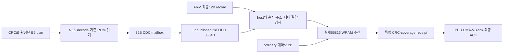

# NES395: tile 선행 저장 소유권과 공동 실행기 교체 예산

## 이번 판정

**기존4KiB staging을 tile FIFO3584B+ordinary 예약512B로 나누고,host84MHz·NES 클록별 RAM 실행기가 host/source/plan/queue/SPI 제어를 함께 대체하는 구조를 다음 구현 경계로 정한다.** tile 저장은 ARM 최종 record를 기다리지 않지만,SNES 공개·CRC/receipt·최종 ACK는 여전히 record 결합과 실제 소비를 요구한다. 자동 DMA descriptor 생산기를 다시 추가하지 않는다.

395는 구조·삭제 예산·실제 포트 계측 단계다. 새 실행 RTL과 새 whole MAP을 구현한 단계가 아니다. 실제 ARM·IRQ·2슬롯·ROM·native65816 service를 유지한394의29개 RTL/ELF에 **관측기만** 추가했다. 최종 실패 시각264.068523133ms까지394와 정확히 같다. 고정907 기한250.090631567ms 실패·911 미도달·17574comb는 해결되지 않았다. 구조 선택을60fps/FIT 승인으로 바꾸지 않는다.

## 원인 확인: record 대기만이 아니다

394에서는 tile 한 개가32B mailbox에 남아 있으면 NES tile 실행과 후속 plan도 멈춘다. host는 현재 record의 staging→SNES WRAM 수신→실제 CRC/receipt가 끝날 때까지 다음 tile을 staging에 복사하지 못한다. 따라서 ARM record를 조금 일찍 발행하는 것만으로는 충분하지 않다.

실제 cold905 계측:

|사건|절대 시각|
|---|---:|
|첫OBJ tile|66.145604ms|
|다음OBJ slot1/byte0의 backpressure 시작|66.166277ms|
|BG1312B 첫 actual read|66.204832ms|
|현재 ROM 허용창의 상한|66.430790ms|
|BG source receipt 완료|66.740799ms|
|OBJ slot1 재개|66.741958ms|
|마지막OBJ tile|82.046558ms|

backpressure0.575681ms 중0.535967ms가 BG의 실제 read→receipt 구간과 겹친다. ROM 창을 약0.311ms 넘긴 뒤 재개해 다음16.639411ms 주기를 기다린다. 앞선394의 “record가 확정되지 않아 생긴 대기” 설명을 이 계측으로 좁힌다. **BG를 읽는 동안 OBJ를 별도 주소에 저장할 소유권**이 핵심이다.392의 마지막OBJ66.295903ms는 같은 ROM 창 상한보다0.134887ms 이르지만,그 결과를 새 실행기에 그대로 이식한 시간 성과로 세지 않는다.

cold906의 tile backpressure 합계는2.608347ms다. 여러 짧은 대기가 ROM 창 경계를 넘길 수 있으므로 합계만 빼서 완료 시각을 예측하지 않는다.

## 비교한 후보

|후보|시간/소유권|회로 판단|
|---|---|---|
|기존 자동 tile chunk/descriptor 복원|생산과 SNES 수신의 겹침은 복원 가능|삭제한 별도 제어를 복원한다.2321 순삭제 경계가 아니므로 거부|
|394 host 위에 prefill adapter만 추가|주요 backpressure를 줄일 가능성|host2022/source398/plan354/queue221을 남겨 회로 목표를 충족하지 못함|
|두 클록의 공통 RAM 실행기+저장 FIFO|생산·record 결합·실제 소비를 분리|다음 구현 대상으로 선택.1395comb 이하와 고정 일정은 아직 미검증|
|NES 작업을 전부84MHz host로 이동|source/query/ROM CDC와 추가 응답 경계 필요|codec·cache·ROM arbiter의 검증 경계까지 넓어진다.이번 삭제 예산에서 무료로 제거하지 않음|

## 저장·소비 소유권

1. NES producer는 실제로 수락한 current-generation plan만 실행한다. 미래 tag를 만들지 않는다.32B mailbox는 host가 payload와 식별 stamp를 안전하게 저장하면 반환한다. ARM final record나 SNES receipt를 기다리지 않는다.
2. host의 tile FIFO tail은 **저장된 byte 수**이고,SNES read cursor/consumed count가 아니다. TILE prefill에는 token·PPU destination·DMA descriptor를 만들지 않는다.
3. host는 ARM record의kind/first/count/generation·store/destination 관계를 검사하고,해당 tile stamps와 정확히 일치하는 순서의 payload만 공개한다. match되지 않은 FIFO byte는 SNES가 읽을 수 없다. source checksum과 실제 coverage도 아직 증가시키지 않는다.
4. source read와 private CRC/coverage drain 뒤 fresh32bit token을 확인해야 소비를 공개한다. 이때 FIFO payload/stamp의 head를 반환한다. HEAD 저장 credit,DATA 소비,PPU 완료는 합치지 않는다.
5. ordinary용512B는 고정 예약한다. literal의 MAP fragment244B/nonmap224B/zero-tail2B뿐 아니라 **실제71frame에 있는480B decoded OAM repeat**를 수용한다.256B 예약안은 이 전체 대조에서 거부했다.합법적인 더 큰 repeat는 같은 ARM record 안에서 source fragment≤512B로 내부 분할한다.첫/마지막 flag와 offset을 유지하고 각 fragment마다 fresh token·actual read/CRC/receipt를 요구한다.E1 storage credit은 안전한 seed/record 저장 뒤 반환할 수 있지만 consumed packet count는 마지막 내부 fragment에서만 증가시킨다.새 wire byte는 없어도 token·receipt·IRQ 실행 비용은 추가되므로 별도로 검증한다. tile FIFO가 가득 차도 queue 앞의 ordinary가 진행해 뒤의 TILE record에 도달할 수 있어야 한다. 현재 ordinary fragment는 하나만 연다.
6. BG-close와 frame END는 구분한다. END/fence는 남은 prefill·stamp·active fragment·독립 검사 drain을 확인한다.12view read·실제 PPU 실행·VBlank·최종 ACK를 그대로 요구한다.
7. input source ring의 다음 frame 문맥과 현재 display/tile 문맥을 분리한다. stamp는 현재 display lease에 속하며 frame 전환 전 반드시 비워져야 한다. source credit 반환을 display ACK로 취급하지 않는다.

### 왜 두 개의 extent descriptor만으로는 부족한가

gapped BG slot0,2,4 같은 합법적인 연속 입력은32B만 저장해도 두 extent를 채운다. 뒤의 plan/record 진행이 필요할 때 작은 extent 두 개만 유지하면 다시 순환 대기를 만들 수 있다. payload bank 수를 늘리는 대신 **tile 단위4B stamp ring**을 둔다. stamp는 generation16+kind1+slot10이며,길이16/32B는 kind로 정한다. 남은 bit는0이어야 한다. DMA 실행 record의 복제가 아니다.

기존 plan mailbox는 마지막 plan의 CHECK에서 반환되며 tile_done까지 기다리지 않는다. 따라서 선행량은 단순32plan이 아니라 **실행 중1+sealed16+host pending16=33plan**으로 잡아야 한다.

ARM이2048B 이내에서 TILE span을 확정하고 수락한 plan을 계속 account한다는 조건 아래:

|상한|필요량|예약|잔여|
|---|---:|---:|---:|
|최대 미결 TILE job+33plan×32B+mailbox32B|3136B|3584B|448B|
|job2048B/16B+33plan+mailbox1|162stamps|192|30|
|내부 ordinary fragment 상한|512B|512B|0B|

6528가지 job-size/kind/lookahead 조합의 **용량 산술**을 검사했다. 실제 M4가 만든71frame TILE sequence도 원래 명령의kind/slot/순서와 대조했다. 최대 관측치는905의1312B job/전체1632B·92stamps다. 이 계산은 새 RTL의 liveness/STOP/race 검증을 대신하지 않는다.3136B는 **아직 실행 record가 없어 소비를 시작할 수 없는 prefix의 의존량 상한**이다. 이미 record가 공개된 이후의 전체 미소비 byte를 언제나3136 이하로 유지한다는 뜻은 아니다.그 뒤 FIFO full은 기존 소비로 풀려야 한다.1..3418B의 repeat 분할 용량 산술도 검사했다.이는 새 내부 fragment lifecycle의 RTL/시간 검증이 아니다.

### 필수 ARM 발행 frontier

실제 `nes_refill267.c`의 io259는 호출당 최대2batch를 공급하고,`prefill287`은 돌아온 뒤에야 tiles290을 호출한다.tiles290은 한 번에16record만 account한다.따라서 hardware plan bank가 두 개라는 이유만으로 **누적 미account 발행량≤33**이 보장되지는 않는다. 더 빠른 prefill이 bank credit을 계속 반환하면 이미 완료한 미account plan이 FIFO에 누적될 수 있다. 이 조건을 기존 ARM이 충족한다고 가정하지 않는다.

다음 구현에32bit `published/accounted` 두 frontier(+8B static 제안)를 필수로 추가한다. E9를 내보내기 전에 **published+batch_count≤accounted+33**을 확인하고 batch_count를 먼저 예약한다.accounted는 기존 tiles290의 검증·bulk 제출이 성공해 at290이 실제 commit된 위치에서만 증가시킨다.기존 BG-close도 account하며,마지막 END는 conservative한 한 항목으로 남아도 frame 종료 뒤 reset한다.accounted가 published보다 앞설 수도 있으므로 unsigned 뺄셈으로 판정하지 않는다.앞서 계산한 plan이 아직 SPI로 나가지 않은 경우에도 그 record의 실제 tile 공급을 허용해야 한다.

frontier가 가득 차면 E9 공급 loop만 멈추고 원래 E1/E2 처리를 마친 뒤 foreground accounting으로 돌아간다.이 상태에서 추가 planner 작업/WFI로 accounting 복귀를 막거나 SPI를 재귀 호출하지 않는다.애매한 SPI 실패는 기존처럼 terminal이다.25760가지 frontier 산술 조합을 검사했지만 새 M4 기계어·IRQ·시간은 아직 측정하지 않았다.미account 제한과2048B job 상한,ordinary 예약을 모두 실제 구현해야 용량 조건을 적용할 수 있다.2048B TILE 상한은 ARM 검사에만 의존하지 않고 새 FPGA admission에서도 token/FIFO 공개 전에 거부해야 한다.현재65816의 수신 길이 검사도 보존한다.

## RAM 배치와 클록별 포트

staging4KiB의 host writer A / SNES read B는 유지한다. address0..3583는 tile FIFO,3584..4095는 ordinary다. 공개한 DMA에는 canonical address와 별도의 physical read cursor를 cache해 byte마다 나눗셈/전체 record fetch를 하지 않는다. FIFO wrap은 제한된 cursor 갱신으로 처리한다. SNES의400800 상대주소 ABI는 유지하되 물리 backing 주소는 공개된 job의 소유권에 따라 선택한다.

기존32B tile payload RAM은 이미 하나의 M9K를 사용한다. 같은 논리 RAM을1024×8로 확장해 다음 배치를 검토한다.

|주소|내용|쓰기/읽기 소유권|
|---|---|---|
|0..31|기존 tile mailbox payload|NES write /host read,기존 CDC 반환 후에만 재사용|
|32..799|192×4B tile stamp|host A,head/tail로 미소비 항목 보호|
|800..927|host128B 문맥|host A:current display/record·source header·queue/SPI resume|
|928..959|NES source32B 문맥|NES B:source writer/footer resume|
|960..1023|NES plan64B 문맥|NES B:decoded plan/lease/cursor/resume|

두 포트가 같은 주소를 동시 write하지 않도록 주소 영역과 소유권을 고정한다. NES 쪽 tile byte write와 context save가 겹치면 tile handshake를 우선하고 context save를 재개한다. host 쪽도 SNES read/capture·SPI ingress를 우선하고 tile copy/metadata를 중단·재개한다. SRAM을3포트처럼 취급하지 않는다.

source ring1024B의 NES write/host read,plan RAM1024B의 host write/NES read,queue/expected1024B는 별도 물리 RAM으로 유지한다. E9는512B까지이므로256B output slot에 억지로 넣지 않는다. **공통화하는 것은 header/cursor/credit/완료 실행 제어**이며,E9의 unpublished plan-bank admission과 E1의2packet storage credit은 각각 보존한다.

host 실행기와 NES 실행기는 클록을 건너 한 ALU를 공유하지 않는다. 각 클록에 고정 폭 ALU/분기 실행기를 두고,cold resume는 RAM,read-critical cursor와 decoded current plan은 작은 hot register cache에 둔다. source byte마다32B 문맥을 통째로 저장하거나,SNES byte마다12B record를 다시 읽는 설계는 허용하지 않는다. codec/query·CHR cache·ROM arbiter·독립 validator 본체는 보존 비용이다.

### 실제 포트 계측과 deadline

|394 cold 실제 관측|905|906|
|---|---:|---:|
|NES source RAM write clocks|5816|463|
|plan RAM read clocks|656|640|
|동일 NES edge의 두 요구|0|0|
|host queue write와 actual read event 동시 edge|27|24|
|host packet write와 실행기의 packet read 동시 edge|1|2|
|actual read 최소 간격|34host clocks|34host clocks|

source/plan 동시 요구0은 cold에서만 관측한 값이다. 입력·표시 overlap에서0이라고 가정하지 않고 재개 문맥을 유지한다. host 동시 요구는 실제 있으므로 하나의 opcode를 끝까지 실행한 뒤 대응하는 구조는 부적절하다. SNES capture/CRC ready는 기존 hot 경로를 유지하고,공통 실행기의 긴 작업은 interruptible해야 한다. read service≤24host clocks를 초기 gate로 둔다.34clocks 관측을 WCET/실기 상한으로 승인하지 않는다. trace의1ns 반올림은 각각의 동일-clock 구간을 정수clock으로 복원해 계산했다. SPI byte마다256host clocks의 여유도 동시 SNES 요청·CRC·context 비용을 지불해야 한다.

snapshot/CRC8의200bit 회전 레지스터는 RAM field reader로 대체하고,고정 MISO/SS/SCK 수신·request CRC·serial/sequence·status CRC 검사는 남긴다. response byte를 준비하는 시간,입력 byte pending latch와 IRQ key 갱신도 새 회로 비용이다. stamp마다 새로운 IRQ를 만들지 않고,기존 plan/storage/consume 진행을 기존 응답·IRQ에서 알린다. E2 횟수가 감소한다고 가정하지 않는다.

## 실제 삭제 경계와 예산

기준 whole Lite394는22416LE/17574comb/9024FF/300640bits다. 보존 codec/checker2347과 나머지11511을 고정하면,제어3716을 **1395 이하**로 대체해야15253comb와155 여유 목표에 도달한다.

|삭제할 현재 self 경계|현재comb|새 경계의 상한|
|---|---:|---:|
|host descriptor/manifest/receipt FSM|2022|RAM host 실행기400|
|source transport+plan transport+endpoint|398+354+99=851|NES 실행기280(host 작업은400에 포함)|
|SPI snapshot/CRC/주소 제어|579|SPI bit/CRC/RAM snapshot240|
|queue cursor/credit/sequence/소비 완료 제어|221|credit/namespace100|
|tile link의 저장 완료 제어|43|새 FIFO 소유권/bridge140|
|새 program/context RAM decode·중재|0|150|
|변동 예비|0|85|
|합계|3716|1395|

최소 순삭제는2321이다. host에서만1622,source/plan에서571,SPI339,queue121을 줄여야 하고,tile/bridge 증가97과 새 RAM 중재150·예비85를 지불한다. **이 표는 합성 성과가 아니라 구현 중단 여부를 결정할 상한이다.** SPI579를 그대로 두면 같은 나머지 상한에서339comb가 모자란다. source/plan851을 전부 무료로 없애도1470comb가 더 필요하므로 source 단독 교체로 해결되지 않는다.

공통 microprogram은 host/NES 두 read port의512×18 ROM을 초기 배치 목표로 둔다. 이전 codec 실험의 전체 N5 microcode를 재구현하지 않고 전송/주소/완료 제어만 맡는다.512word나4KiB를 절대 용량 제한으로 만들지 않는다. 초과하면 실제 ROM block·decode·latency를 whole 비용에 추가하고 동시 목표를 다시 판정한다. 현재 논리 RAM 산술은300640+(1024−32)×8+512×18=**317792bits**다. 기존 M9K의 작은 RAM 확장과 ROM의 물리 packing/복제 여부는 새 whole MAP에서 확인해야 한다. 이 산술을 M9K/FIT 여유로 승인하지 않는다. whole FF는 최소39개를 줄여8985 이하를 gate로 둔다.

## 고정907 일정의 회복 예산

394 startup 초과는13.977892ms다. ROM 한 주기16.639411ms를 **실제로** 회복할 수 있다면 추가 실행·중재·ARM/SPI/IRQ 비용에 남는 총 상한은2.661520ms다. 이는 조건부 산술이며,ROM 창을 하나 회복했다는 측정이 아니다. 다른 frame의 창을 독립 이득으로 더하지 않는다.

더 엄격한 조건은 첫OBJ 창이다.392의 마지막OBJ와 현재 창 상한 사이에는0.134887ms만 있다. 먼저 source/plan decode·tile stamp/copy·추가 SPI/IRQ의 **critical path 증분≤0.100ms**를 임시 gate로 둔다. E2 하나만 추가돼도14B wire가42.667us이며 SS gap·ARM 비용은 별도다. 따라서2.66ms 전체 예산만 보고 첫OBJ 창의 작은 여유를 무시할 수 없다.

출력 ABI·D4/MASK/SHIFT·compact E9와 실제 ARM 최종 record 순서를 우선 유지하므로 새 wire field 증분 목표는0B다.필수 publication/accounting frontier는 E9 발행 시점을 바꾸며,IRQ·credit 변화로 E2/WFI/명령 수도 달라질 수 있다.8B static 제안과 해당 비용을 실제 M4에서 다시 실행해 지불한다. master46561ps,phase0,ROM_WINDOW1,907 capture5371247,49104clock·512reserve·기존 cutoff는 고정한다. 고정 startup을 통과한 후에만907/908 actual source-start·ROM cycle pair와 별도 연속911/71/heavy7·다중 위상을 비교한다.

## STOP·독립 검사·구현 gate

미공개 FIFO/stamp는 STOP/fault/lease 불일치 때 무효화한다. payload를 RAM에 썼다는 이유로 receipt/expected를 갱신하지 않는다. 기존 actual read의known CRC·독립 exact bitmap·중복 거절·H2 binding과 final scan은 보존한다. token/serial 소각은 공통 cancel에서 되돌리지 않으며,재시작은 ROM reader drain·CDC quiescence와 별도 입력/표시 문맥 재설정을 요구한다. 늦은 tile_done/ACK가 old generation을 공개하면 안 된다. RAM 초기화도 양쪽 도메인이 quiescent일 때 각 소유 영역만 수행하며,live NES write 중 host가 전체 RAM을 clear하지 않는다. STOP 뒤에는 valid/pointer로 무효화하고 RAM write를 동결한다. 초기화되지 않은 resume 문맥은 실행하지 않는다.

구현은 최소 다음 gate를 통과해야 한다.

1. 새 FIFO/192stamp/ordinary512B 예약·repeat 내부 분할을 공동 host/source/plan/queue 실행 경로와 함께 연결한다. 먼저 adapter만 추가한 결과를 최종 회로 개선으로 세지 않는다.
2. actual byte가 현재 canonical record와 결합되는 경로,두 클록 포트 중재·source/plan 동시 요구·2슬롯 순환 대기·STOP256clock RAM freeze·fresh final fence를 검증한다.394의17RTL/7CPU guard와 기존 독립 checker를 유지한다.
3. 같은 기능 RTL/actual ARM/native 프로그램을 whole Lite MAP에 넣어≤15253comb/FF≤8985 및 실제 RAM packing을 확인한다. 미달하면 opcode/seed/FIT 반복으로 보완하지 않고 역할/소유권/하드웨어 경계를 재검토한다.
4. 실제 ARM/refill/IRQ/SPI·ROM 경쟁에서 첫OBJ critical 증분과 고정907 startup을 먼저 검증한다. source geometry prefix·D4 credit·첫 causal hint가 context save 때문에 늦어지는 비용도 계측한다.377에서 본 수십us의 첫 hint 창 여유를 새 문맥 저장이나 MMC4/5 비용에 무료로 배정하지 않는다. 그 뒤911·71/heavy7·복수 위상과 fullresident/실기로 진행한다.

395의 용량 모델과 관측기는 위 gate1–4를 통과한 구현이 아니다. 생산 기준375RTL/377ARM,394의 구현/실패 증거,production227/GBC164/saveSRAM을 보존한다. MMC4/5 예산·전체 WCET·fullresident audio/input·정상 STOP 재개·FIT/STA·실기60fps는 모두 OPEN이다.
