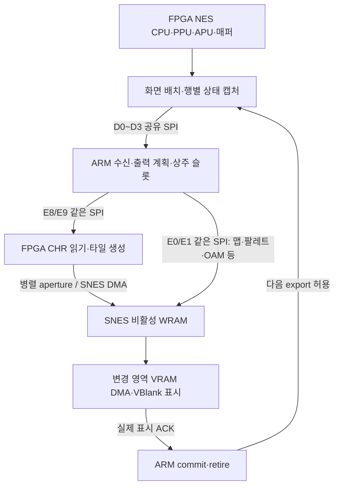

# NES227 이후 전체 화면 경로 회고 — 구현 중지

2026-10-18. PR125 머지 `459bc6661fc94b2324737be0ed2cb45ed62bc9a7`와 NES227 실기를 기준으로 검토했다. 사용자가 구현 중지를 요청했으므로 **228 후보를 더 고치거나 시험판을 만들지 않는다.** 이 문서는 다음 설계를 판단하기 위한 회고다. [계산·소스 해시](../analysis/nes-video-retrospective228.json), [227 실기 원분석](nes-game227-hardware01.ko.md).

## 판단

**현재 가장 확실한 병목은 공유 SPI를 통과하는 화면 정보의 양과, 그 앞뒤 처리를 직렬로 연결한 구조다.** FPGA 타이밍을 맞추고 타일 생성기를 빠르게 만드는 것만으로는 해결되지 않는다. SNES 쪽도 처리·DMA·VBlank 제한이 있지만, 현 로그에서 전체 지연을 SNES VRAM 또는 FPGA 연산 하나의 탓으로 돌릴 수는 없다.

SNES 타일·스크롤 기능을 활용하는 방향은 타당하다. 그러나 지금의 전달 방식이 60fps에 맞는다는 뜻은 아니다. **현재 전송량과 클럭을 그대로 유지한 구조로는 60fps가 성립하지 않는다. 재사용·전달 경로를 바꾼 구조의 가능성은 아직 열려 있지만 미입증이다.** SMB3/MMC3의 지속 스크롤과 모든 매퍼·장면의 보장은 별개다.

## 실제 데이터 경로

타일 픽셀은 이제 ARM을 왕복하지 않는다. 그러나 타일을 어디에 놓을지 설명하는 데이터는 FPGA→ARM으로 넘어오고, ARM이 계산한 맵·메타데이터가 같은 SPI를 통해 다시 SNES 쪽으로 간다. **픽셀 우회는 완료됐지만 화면 처리 전체의 우회는 아니다.**

201 이후 다음 화면 캡처와 현재 표시 준비의 일부는 겹친다. 반면 `nes_capture_lease201.sv`의 `export_permitted`는 `waiting_display` 동안 닫히며, ARM의 `nes_native_runtime165.c`는 수신→계획→finish→SEAL/ACK→retire를 순서대로 처리한다. 따라서 수집 중첩과 전체 파이프라인을 구분해야 한다.

## 수치로 확정되는 병목

227의 60.06초 동안 최종 표시 ACK는 465회다. 전체 평균 7.74회/초, 평균 완료 간격 129.16ms다. 이는 실측 CRT 고유 프레임 수 또는 NES 코어 내부 FPS가 아니다. 영상·체감과 함께 출력 처리량 지표로 사용한다.

| 단계 | 누적 | 표시 완료 1회당 평균 | 해석 |
|---|---:|---:|---|
| 화면 정보 수신 | 21.63초 | 46.52ms | SPI·해석·대기 포함 |
| 계획과 타일 준비 | 17.26초 | 37.12ms | BEGIN 2.00 + planner 15.83 + finish 19.29ms |
| SEAL·최종 ACK | 20.57초 | 44.24ms | 압축·송신·소비·업로드·대기 포함 |

10ms 계측, 단계 외 작업, 마지막 미완료 수신 때문에 완전한 벽시계 분할은 아니다. planner도 callback을 포함하고 finish도 source·bulk·drain을 포함한다. **37ms를 ARM 계산, 44ms를 SNES DMA라고 부르면 잘못이다.**

실제 SPI 설정은 PCLK2/32 = 2.625MHz다. 한 바이트당 8클럭이며 아래는 전송 간격·CPU 비용을 제외한 순수 wire 시간이다. 동일 전송의 TX/RX를 이중 합산하지 않았다.

| SPI 용도 | 바이트/완료 | wire 시간/완료 |
|---|---:|---:|
| D0~D3 화면 정보 수신 전체 | 7,036.76 | 21.45ms |
| E8 타일 준비 상태·descriptor 등 | 2,249.81 | 6.86ms |
| E9 생성 계획 | 88.26 | 0.27ms |
| E0 SNES 큐 상태 | 4,130.75 | 12.59ms |
| E1 맵·팔레트・OAM・제어 등 | 3,447.57 | 10.51ms |
| 기타 계측 전송 | 7.00 | 0.02ms |
| **합계** | **16,960.15** | **51.69ms** |

직접 aperture DMA와 별도 오디오/service 통신은 이 합계 밖이다. 이 wire 시간은 위 단계 시간에 이미 포함되므로 129ms에 다시 더하지 않는다.

60Hz 한 구간의 SPI 이론 용량은 **5,468.75B**다. 현재 평균에서 최소 **67.76%**를 없애야 wire만 겨우 16.67ms에 들어간다. CPU·간격·다른 SPI 서비스의 여유까지 남기려면 더 줄여야 한다. D1 인코딩 payload만 5,865.32B/17.88ms로 이미 예산을 넘는다. 첫 레벨이 주로 나오는 것으로 보이는 중간 묶음에서는 D1만 19.3~19.8ms다. 정확한 촬영/호스트 동기화와 동일 입력 비교는 아니다.

이는 **현재 관측량을 유지했을 때의 제약**이다. 지금은 표시 사이에 여러 NES 프레임이 지나므로 한 번에 바뀌는 영역이 커질 수 있다. 실제60Hz로 소비하면 매번의 이동·dirty 양이 줄어드는 선순환도 가능하다. 따라서 현재 E1 바이트/완료를 미래60Hz의 필수량으로 고정하지 않는다. 이를 판단하려면 연속된 NES 프레임의 스크롤 자료로 delta를 계산해야 한다. 낮은 표시 빈도로 샘플된 화면만으로 후보를 탈락시키거나, 반대로 정지 화면으로 낙관하지 않는다.

**상태 확인도 상당히 비싸지만 그것만 없애면 된다는 결론은 아니다.** E0+E8은 계측 바이트의 약37.62%다. 이 둘을 비용 없이 전부 없앤다는 불가능하게 낙관적인 가정에서도 나머지가 32.24ms다. 일부 상태 조회는 실제 소비 지연의 결과다. 최종 표시 확인을 지우면 비활성 은행·세대·소스 수명을 보장할 수 없고, 소비 속도도 빨라지지 않는다. 기존 E1은 이미 4패킷 window다. TCP식 한 패킷마다 정지하는 구조라는 설명도 정확하지 않다.

반면 새로 생성해 aperture로 보낸 타일은 평균 약249B/완료다. 상주 슬롯 재사용이 이미 동작하며, 현재 E9도 전체의 약0.52%뿐이다. 타일 생성 계획의 압축을 더 정교하게 만드는 것은 가장 큰 병목을 겨냥하지 않는다. 다만 평균은 장면 전환의 burst를 숨기므로 PSRAM 읽기 대기를 완전히 배제할 근거는 없다.

PSRAM의 `native_fill_slot`은 scanline242~259와 CPU/DMC 등의 안전 조건으로 제한된다. 과거192 분석의 낙관적 상한은 약2046 byte reads/NES frame이며 실제 경쟁은 더 줄인다. 공급창이 짧아 평균량이 작아도 늦게 도착한 요청은 다음 창까지 기다릴 수 있다. finish19.29ms를 설명할 후보지만 현재는 실제 원인별 대기를 계측하지 않았으므로 확정하지 않는다. 읽기창을 무조건 넓혀 이미 해결한 ROM 응답·게임 정지 문제를 되돌리는 방법은 피한다.

## 무엇을 해봤는가

| 작업 | 상태와 성과 | 남은 문제 |
|---|---|---|
| 실행·정지·ROM 응답·화면 캡처 조건 수정 | 첫 레벨 실행, 음성, 조작, 메뉴 복귀 실기 성공 | 출력60fps와 별도 문제 |
| SPI 묶음·짧은 계획·4패킷 window | 구현됨 | 모든 종류의 트래픽은 여전히 공유 예산 |
| 병렬 aperture로 타일 픽셀 전달 | 188~209 구현·실기 사용 | 입력 geometry와 출력 metadata는 SPI에 남음 |
| 물리 패턴 상주 슬롯과 은행별 유효성 | 211 이후 구현됨 | 전체 화면 설명을 받는 비용까지 없애지 않음 |
| 상류 dirty 목록을 SNES까지 전달 | 212 이후 구현, 이전 전체 비교/fallback 대체 | 맵 단위·상태 전송·소비 CPU·VBlank 비용은 남음 |
| 다음 화면 캡처 중첩 | 201 이후 구현됨 | 다음 export/ARM 작업은 최종 표시 완료에 묶임 |
| geometry 패킹 | 223 구현됨 | 한 프레임 내부 표현 절감, 프레임 간 delta는 아님 |
| 64열 원형 맵 | 225 구현됨 | SNES 출력 맵 재사용. 입력 snapshot 전체 비용은 별도 |
| 일반 행 계산·키 조회 가속 | 221 계열 인덱스 및226 fast path 구현 | 226에서 planner는 줄었지만 전체 수신·완료 비용이 큼 |
| 반복 OAM 압축 | 227 구현·실기 정상 | 효과는 제한적. 장면 차이 때문에 순수 개선율 미확정 |
| 64B→8B 맵 변경 단위 후보 | 228 로컬 실험, **보류** | C RUN 모델 통과했지만 실제65816 픽셀 비교의 frame21 불일치 |

209의 평균3.41완료/s에서227의7.74로 올라온 것은 진행 방향에 일부 실효가 있었음을 보여준다. 다만 서로 다른 조작·장면이라 통제된2.27배 향상으로 주장하지 않는다. 특히 정지 화면 개선은 지속 스크롤 합격을 대신하지 못한다.

## 아직 하지 않았거나 충분히 확인하지 않은 것

1. **입력부터 프레임 간 변경만 전달하기.** 현재 exporter는 압축해도 화면의 그룹·행·오브젝트·팔레트 정보를 다시 내보낸다. 재사용을 ARM이 수신한 뒤 판정하면 입력 비용을 이미 지불한 것이다. source 쪽에서 안정된 참조와 변경 정보를 남기는 방식은 구현하지 않았다. 단순 직전 캡처 비교는 프레임이 건너뛰면 기준이 틀릴 수 있으므로 수신자가 가진 base/version을 기준으로 해야 한다.
2. **화면 메타데이터의 병렬 전달.** 기존 aperture는 타일 픽셀용이다. geometry 또는 SNES용 메타데이터까지 병렬 경로로 전달하는 구조는 아직 생산 구현이 아니다. ARM이 SPI로 다시 채우는 버퍼는 같은 왕복을 다른 주소로 옮긴 것뿐일 수 있다.
3. **전체 단계 중첩과 소유권 분리.** 다음 캡처는 있지만 다음 수신/계획까지 이어지는 파이프라인은 없다. 다만 같은 SPI의 합산 점유는 겹칠 수 없고, ARM에 화면 작업 공간 하나를 더 복사할 여유도 없다. 작은 불변 descriptor와 자원별 수명을 나누는 설계가 먼저다.
4. **반복 준비를 로드 시점으로 옮기기.** 불변 CHR-ROM의 일부 변환·색인·배치를 처음에 준비할 가능성은 남아 있다. 현재는 실시간 타일 생성이다. PSRAM 주소/포트 경쟁, OBJ 변환·mask, CHR-RAM과 매퍼의 fetch 시점 효과를 포함해야 하므로 즉시 채택할 해법은 아니다.
5. **실제 제한 요인을 분리하는 최소 측정.** E8 횟수는 PSRAM miss 수가 아니며 SEAL은 순수 VBlank 대기가 아니다. 실제 source 안전 읽기창 대기, bulk ready→consume 지연, SNES CPU 실행/복원 시간과 VBlank 횟수는 아직 분리되지 않았다. 새로운 거대 디버그 프레임워크 대신 후보 선택을 바꾸는 항목만 필요하다.
6. **더 빠른 SPI의 적합성 검증.** 현재판은2.625MHz이며 상향의 실기·전기/타이밍 적합성은 입증하지 않았다. 저비용 가능성 조사 대상으로 남길 가치가 있다. 하지만 2배여도 현재 wire만25.84ms이고, 60Hz에 현재 바이트를 싣는 최소 약8.14Mbit/s조차 CPU/대기를 해결하지 않는다. 클럭 상향을 전체 해법으로 간주하지 않는다.

## FPGA 문제인가, SNES 사용 방식 문제인가

정확성을 깨던 FPGA 배선·CDC·lifetime 오류를 해결한 것은 필요했다. 현재 영상 정체를 모두 그런 문제로 재해석할 이유는 없다. 음악·조작·정상 종료가 유지되고 대량 전송 및 단계별 시간도 설명 가능하다. 그렇다고 음악 정상만으로 NES CPU/PPU 전체가 정확히60Hz라고 인증할 수도 없다.

현재 FPGA는15249/15408LE,961/963LAB,47/56M9K다. 여유는159LE·2LAB·9M9K이며 **RAM9개가 남았다고 제어 논리·배치 여유가 충분한 것이 아니다.** ARM margin1800B(기존 최소 gate1024B), SNES4KiB client 본문 잔여224B다. 장치를 더 잘 분담하려면 기능을 계속 추가하기보다 기존 경로를 대체하며 공간을 회수해야 한다. 저장용 SRAM은 사용하지 않는다.

SNES 타일 출력 자체는 활용 가치가 있다. 과거164도 SNES PPU로 표시했으며, 전체 픽셀 경로는 매 화면57,344B를 옮겼다. 이를 그대로 되돌리는 것은60fps 해법이 아니다. [Anomie의 SNES 타이밍 문서](https://raw.githubusercontent.com/gilligan/snesdev/master/docs/timing.txt)는 DMA가 바이트당8 master cycles를 쓰고 CPU를 정지시킴을 설명한다. VRAM 업로드 가능 구간과 설정 비용도 따로 고려해야 한다.

현재 문제는 SNES를 안 쓰고 있다는 것이 아니라, **NES 화면을 SNES의 적은 변경 명령으로 유지할 수 있는 경우에도 그 앞에서 화면 설명을 넓게 재수신·재계획하는 비용**이다. 스크롤 좌표와 새 가장자리만으로 되는 경우, CHR bank/행별 효과까지 바뀌는 경우를 분리해야 한다. 실제 첫 레벨의 최소 변경량은 아직 계산되지 않았다. 모든 게임을 단순 카메라 이동으로 환원하지 않는다.

[PocketNES 실제 PPU 코드](https://github.com/Dwedit/PocketNES/blob/main/src/ppu.s)의 dirty rows/tiles와 cache는 변경 정보가 생기는 곳에서 유지한다는 참고다. GBA 처리량을 SNES에 적용하는 근거는 아니다. [Project Nested의 SNES 그래픽 소비기](https://github.com/Myself086/Project-Nested/blob/master/Assembly/Project/Gfx_Interrupt.asm)에는 스크롤·CHR bank·타일·미러 변경 명령과 VRAM 큐가 있다. 배울 부분은 변경의 의미를 유지한 작은 명령이지, 프레임 전체를 압축하는 기법만이 아니다. [프로젝트 설명](https://github.com/Myself086/Project-Nested/blob/master/README.md)의 JIT 에뮬레이터 전체를 이식하자는 뜻도 아니다. 외부 성공 사례는 우리 공유 버스 예산의 증명이 아니다.

## 진행 방식에서 고칠 점

187·209 회고는 입력 병목·전체 파이프라인·16.67ms 자원 예산을 이미 지적했다. 이후 상주 슬롯·dirty consumer·원형 맵을 구현한 것은 그 계획의 실질적 진전이다. 그러나 **그 뒤에도 입력 병목이 열린 상태로 작은 출력 압축과 갱신 단위부터 개선한 우선순위는 재조정해야 한다.** 228의 불일치를 수정하더라도 전체60fps 가능성이 입증되는 것은 아니다.

앞으로 구현별 “정확히 동작함”과 “목표 처리량을 향한 전체 순효과”를 별도 합격 조건으로 둔다. 소스/생성/소비를 잇는 최소 경계 테스트와 실기 스크롤을 유지하되, 동일 codec/FIT/정지화면 실험을 여러 차례 반복하지 않는다. 이미 통과한 회귀 검증은 변경 경로와 근거가 있을 때만 다시 실행한다. 영상만으로는 원인을 나눌 수 없지만, 합성 시험만으로는 게임 부하를 대표할 수 없다.

## 재개한다면 비교할 설계와 순서

| 후보 | 기대 효과 | 먼저 탈락시킬 조건 |
|---|---|---|
| A. 현재 경로에 입력·출력 공동 delta 적용 | 재수신·재계획·재전송을 함께 줄이고 기존 타일/소유권 기반 유지 | 실제 스크롤 변경량을 넣어도 공유 SPI 합계가16.67ms 초과, 또는 base 유지 공간 부족 |
| B. 기존 병렬 aperture 역할 확장 + 계산 위치 재배치 | SPI 대량 경유를 구조적으로 제거 | ARM이 같은 양을 SPI로 재공급, SNES 변환 CPU 또는 FPGA 제어 자원이 새 병목 |
| C. 불변 데이터 사전 준비 + 실시간 작은 명령 | CHR 반복 읽기/변환과 계획 비용 감소 | 입력 geometry/metadata 비용을 그대로 두면 전체 한계 미해결; CHR-RAM/매퍼 의미 손상 |

세 후보를 모두 구현하지 않는다. **먼저 같은 실제 첫 레벨 스크롤 자료를 사용해 자원별 장부를 만들고 가장 유리한 하나를 고른다.** 227의 로그·영상은 구간/총량 판단에는 충분하지만, 매 프레임 실제 geometry payload와 source miss까지 기록하지는 않았다. 기존 보존 캡처가 해당 장면의 연속 NES 프레임을 포함하는지 확인하고, 부족하면 나중에 한 번의 제한된 수집으로 보충한다. 지금 동일227 실기 재시험이나 새로운 장기 계측을 요청하지 않는다.

장부에는 SPI 전체 바이트, 실제 source 읽기와 허용창, ARM 계산/대기, SNES CPU 작업, VRAM 업로드 바이트·명령 수·VBlank 수, RAM/코드/논리/포트를 같은 장면 기준으로 넣는다. 원형 맵과 캐시가 이미 있다는 조건으로 계산하며 “캐시를 넣으면 해결”로 되돌아가지 않는다.

진행 조건은 **공유 자원별 지속 점유가60Hz 예산 안에 들어가고 여유를 가지는 것**이다. 직렬이라면 합계를, 파이프라인이라면 자원별 점유와 의존성을 검증한다. 지연이16.67ms보다 길더라도 처리량60/s는 가능하지만, 화면 나이와 입력 지연이 계속 늘어나는 큐는 허용하지 않는다. 평균 외 표시 간격의 긴 꼬리·반복 화면도 확인한다. 장면 전환과 캐시가 데워진 지속 스크롤은 별도 보고한다.

후보가 이 조건을 만족하면 최소 실제 경계 검증 후 실기 첫 레벨로 간다. 만족하지 못하면 더 FIT하거나 타임아웃·클럭 조건을 완화하지 않고 경로를 다시 선택한다. 목표를 임의로30fps로 낮추지 않는다. MMC4 latch, MMC5 ExRAM/CHR/행별 효과와 CHR-RAM의 fetch 시점 정보, reset/save-load 시 cache 무효화, 최종 표시 ACK를 보존한다. 매퍼 확장은 현재의159LE 여유만으로 가능하다고 약속하지 않는다.

## 중단한228 후보 보존

`codex/nes-map-granules-228`의 후보4개 Python 도구와 `probes/nes-granules228` 결과는 유지한다. 64B→8B 변경 추적과 비용에 따른 기존 방식 선택을 시도했으나 실제65816 normal 비교에서 frame21 불일치가 발생했다. 원인은 아직 조사하지 않았다. C RUN9frames/6faults/9receiver 경계 통과와 client3712B 빌드는 이 불일치를 덮지 않는다. 이미 진행하던 ARM compile-only는 완료됐지만 budget gate·배포 검증은 수행하지 않았다. ASM/ZIP/실기 배포와 새 PR은 없다.

회고 증거는 별도 `probes/nes-retrospective228`에 기록하며, 기존 봉인227 증거는 수정하지 않는다. **다음 요청에서도 후보228을 자동으로 수리·배포하지 말고 이 회고의 구조 선택부터 이어간다.**
